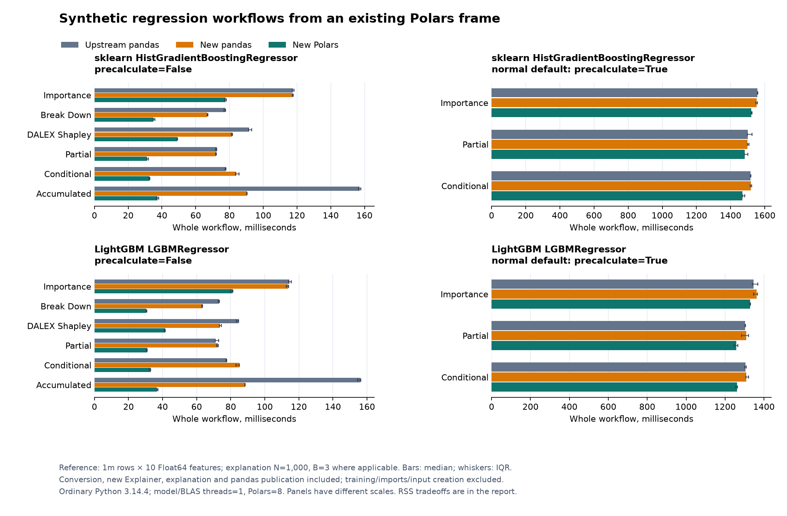

# Narwhals migration: final implementation review

Review date: October 31, 2026. This report supersedes earlier migration status
reports for the source identified below; their measurements remain historical.
The contribution is proposed for **draft PR review**, with the compatibility
boundaries and dependency limitations listed here. It does not certify every
possible dataframe, callback, estimator or extension combination.

## Source and review status

- Measured library: [3b66481e](https://github.com/brunocarlin/DALEX/commit/3b66481e829f581f4c2d427719b1601667973f3d).
- Validation revision: [34cb6300](https://github.com/brunocarlin/DALEX/commit/34cb63005cc2f0edec980d19ba863cc97ede9b17), adding only reference tests/documentation over the same library.
- Unmodified upstream reference: `77ea3ad9580a3b68aaa94d8dca75d11bd527848f`.
- Before the performance refinements: [fdb23b03](https://github.com/brunocarlin/DALEX/commit/fdb23b037e088bb6b9b6e72b2977cce6a04831ae).
- Candidate library Git tree: `c6fec18c50c4a258c5b5b5623462586085e28322`.
- Normalized SHA256 of 135 library Python modules:
  `441d90693067367af8a8727caf0b4a639515a6aef3c39312cfc876e07780ce5e`
  (sorted relative paths, NUL separators, CRLF normalized to LF).
- [Upstream PR #587](https://github.com/ModelOriented/DALEX/pull/587) references
  issue #575 and remains **draft and unmerged** for the author's manual review.
  Upstream's default branch is unchanged by this contribution.

Documentation/evidence commits following 3b66481e do not change the measured
library. Every benchmark worker records its actual source fingerprint; model
and data hashes must match before a trial is accepted.

Recent implementation commits are independently reviewable:

| Commit | Change |
|---|---|
| [fdb23b03](https://github.com/brunocarlin/DALEX/commit/fdb23b037e088bb6b9b6e72b2977cce6a04831ae) | Shared native kernels for old private adapters; index-sensitive pandas and nonlinear hierarchical RNG compatibility |
| [af6b8620](https://github.com/brunocarlin/DALEX/commit/af6b8620748082384097fb7e0e2df439048f1513) | Native Gaussian/profile and loss reductions, fairness text computation |
| [68e658bd](https://github.com/brunocarlin/DALEX/commit/68e658bd486f7ba64d514c24abc5ae82e145dbf2) | CP partition/export ownership and redundant-copy reduction |
| [c4fa6c68](https://github.com/brunocarlin/DALEX/commit/c4fa6c68681469838a3a44f6c6eba7cc6c1074f3) | Minimum-NumPy unsigned endpoints and read-only weights fixes |
| [9966c863](https://github.com/brunocarlin/DALEX/commit/9966c863279b7caefff76b8c6e882d6be6d09c19) | Native base Aspect dendrogram and older model-bridge integration |
| [dfa5d479](https://github.com/brunocarlin/DALEX/commit/dfa5d4796b0a66fad2134d2cd75fd9b9b76716e7) | MultiIndex/partial selectors and missing/non-portable pandas labels |
| [7829e463](https://github.com/brunocarlin/DALEX/commit/7829e46355f83a5a0d32845de5137672553e724e) | Exact legacy pandas Float32 loss reductions and deep integer metadata regressions |
| [a5976113](https://github.com/brunocarlin/DALEX/commit/a5976113093cac21bec212bbf1eb89930995a8a0) | Working duplicate-label pandas importance, metrics and diagnostic tables; explicit publication and export boundaries |
| [3b66481e](https://github.com/brunocarlin/DALEX/commit/3b66481e829f581f4c2d427719b1601667973f3d) | Duplicate-label fairness and LIME; positional typed matrix reconstruction, original column metadata, RangeIndex and explicit subsets |
| [34cb6300](https://github.com/brunocarlin/DALEX/commit/34cb63005cc2f0edec980d19ba863cc97ede9b17) | Actual upstream duplicate-column diagnostic pickle and source-stamped serialization evidence; library unchanged |

## What is migrated

The eager pandas/Polars/Arrow feature table remains in its original backend at
DALEX prediction callbacks. Narwhals stable.v2 supplies dataframe computation;
NumPy/SciPy supply vector statistics. Native result storage and plot preparation
cover importance, Break Down/interactions, DALEX Shapley, ceteris paribus,
partial/conditional/accumulated profiles, metrics, residual diagnostics, Aspect
and triplots, classification/regression fairness, Arena resources/EDA and dataset
loading. Old private helpers adapt shared kernels rather than retaining separate
pandas statistical implementations.

Backend-specific pandas row/assignment adapters deliberately retain legacy row
indexes, duplicate/partial MultiIndex selectors and extension dtypes. They form
the input compatibility layer; native Polars/Arrow inputs do not pass through
pandas. Diagnostic duplicate-label snapshots and external-library matrix
reconstruction also have explicit pandas publication/input boundaries.

Writable default pandas outputs remain compatible. Reading a legacy table makes
its edits authoritative for later plots, exports and serialization. `result_as()`
offers independent native or explicitly selected backend exports. Mixed scalar
values that cannot share one exact native column use typed partitions; unsafe
integer/float combinations are rejected rather than silently rounded.

Real regression/binary sklearn and LightGBM pipelines exercise explanation,
publication, native export, edited views, plots and pickle. The estimator owns
any numerical preprocessing bridge; DALEX does not silently replace its original
native input. External SHAP/LIME/surrogate and neural algorithms retain explicit
matrix/tensor boundaries. See [the implementation contract](../../FULL_MIGRATION.md),
[migration guide](../../NARWHALS_MIGRATION.md),
[recipes](../../NATIVE_BACKEND_RECIPES.md) and
[integration coverage](../../test/INTEGRATION_TESTING.md).

The final compatibility audit added 79 duplicate-label cases and restored the
working pandas importance, performance, diagnostic-table, fairness and LIME
routes. Matrix reconstruction retains physical columns rather than collapsing
duplicate dictionary keys. Duplicate diagnostic columns still need a uniquely
named selection or renamed writable projection at a Narwhals plot/export
boundary. Contributions/profiles already fail on duplicate features in the
unchanged reference; this contribution does not claim to make those inputs valid.

## Tests and independent compatibility checks

The same library source passed **all 23 jobs** in
[run 41183547272](https://github.com/brunocarlin/DALEX/actions/runs/41183547272).
All 23 artifact ZIPs matched their published SHA256 digests before extraction.
The accompanying snapshot audit checks
JUnit results, source fingerprints, minimum installed versions, comparison
outputs and GIL state rather than relying only on job badges.

Reference source files are unchanged. Harness accommodations are documented:
the removed NumPy `in1d` spelling is mapped to `isin` on one-dimensional feature
lists, pickle fixtures receive a pickle-safe residual callback, and child hash
seeds/global initialization are fixed where the historical implementation
depends on them. These do not replace upstream's numerical algorithms.

| Check | Result |
|---|---|
| Complete Python suite | 2,071 passed / 18 optional PPS skips in each of 15 configurations; zero errors/failures |
| Regular versions/platforms | Python 3.10–3.14 on Linux/macOS, Windows 3.14 and a separate pandas 3 job |
| Minimum pandas/numerics | NumPy 1.23.5, pandas 1.5.3, Narwhals 2.0; complete suite |
| Minimum native/plot stack | Polars 1.0, Narwhals 2.0, Plotly 6.0; complete suite |
| Free-threaded Python 3.14t | Complete suite; GIL false after all 21 dependency imports |
| Optional PPS suite | All 18 gated cases pass in its compatible separate job; zero skips |
| Real neural SHAP | 8 PyTorch CPU cases on Python 3.14 and 8 TensorFlow CPU cases on 3.13; zero skips |
| Older Windows estimator bridge | 4 Python 3.10 / LightGBM 4.6 lifecycle cases, each spanning 13 families |
| Installed wheel, pandas-only | 12 core families plus base Aspect dendrogram; no Polars/Arrow/sklearn/SHAP/LIME/statsmodels installed |
| Unmodified upstream numerical comparison | 29 outputs, maximum absolute error 8.881784197001252e-16, rtol=atol=1e-12 |
| Helper/public/text contracts | 265 outputs including indexes, dtypes, mixed metadata and nonlinear seeded hierarchies |
| pandas 3 label comparison | 129-output subset repeated independently; not 129 additional unique outputs |
| Old pickle compatibility | 16 actual unmodified-upstream objects loaded and reused, including duplicate-column diagnostics |
| Upstream figures | 178 figures: 168 complete payload matches; 10 hover-density exceptions described below |
| Real PPS backend parity | pandas/Polars/Arrow matrices have zero numerical difference and native storage |

The ordinary full jobs intentionally gate `test_aspect`'s legacy PPS suite:
`Legacy PPS suite requires DALEX_TEST_PPS=1 and compatible optional dependencies.`
All 18 skipped cases pass in the dedicated job. There are no other final-suite
skips. Warnings remain; passing tests do not mean warning-free dependencies.

Exact-source local validation independently passed 2,071/18, pandas-development
checks passed 289 cases, two focused minimum stacks passed 166 each, and the installed pandas-only wheel passed. The CI
audit and local validation manifest retain the source and environment details.

The ten figure exceptions are six triplots and four base dendrograms. Only
redundant unlabelled collinear hover samples are normalized: removing browser
layout resolution changes their density. Geometry, endpoints, text, tooltips
and layout still match. This is not bit-identical full-payload parity for those
ten figures. Python widget callbacks are covered; exhaustive browser gestures
and rendering are not.

Rerunning the unmodified reference's dendrogram/triplot plot oracle requires a
working Kaleido/browser stack for its historical layout resolver. The migrated
production path no longer invokes that resolver. Figure comparisons inspect
payloads and geometry, not rendered screenshot pixels.

### Float32 precision is a separate contract

Custom-loss pandas Float32, mixed-precision and nullable reductions match the
legacy pandas values and dtypes exactly. Native Float32 accumulation differs
by a few ULPs and is tested with `rtol=8*2**-23` (9.5367431640625e-7) and
`atol=2**-23` (1.1920928955078125e-7). There are 54 instrumented loss cases per
full-suite job. The largest observed native absolute error is 0.00018310546875
for a ratio near 781.829; its measured relative error is
2.342013433632921e-7. pandas' corresponding maximum is zero.

Do not replace this statement with a universal 1e-15 or bitwise parity claim.
The float64 oracle and benchmark results use their own tolerances and report
their actual errors independently.

## Performance protocol

Final local source comparisons use ordinary Python 3.14.4 on Windows 11
Education 10.0.26300, an AMD Ryzen 7 9800X3D (8 reported cores/logical processors)
and approximately 31.1 GiB RAM. Default stack: pandas 2.3.3, Polars 2.1.0,
Arrow 26.0.0, Narwhals 2.28.0, NumPy 2.5.4, sklearn 1.9.1, LightGBM 4.7.0.
The pandas 3.1 confirmation uses an explicit overlay. Desktop background load
is not controlled; these are measured workloads, not universal guarantees.
The measured datasets are synthetic, fully numeric Float64 regression features.
Classification and mixed-schema integrations have correctness coverage, not a
claim to these timing ratios.

One saved fitted model per estimator/data shape is shared by all source/backend
workers. Models have 20 boosting iterations/trees; model seed is 42, dataset
seed 123, explanation seed 42. Model/BLAS threads are one. Polars uses eight
threads except the separate one-thread comparison, so the primary comparison
must not be described as equal-core. Each of five trials starts a fresh worker,
warms the whole workflow once, then times the next run. Source/backend order
alternates between trials. Training, imports and original Polars dataset creation
are outside timing.

Timed totals include conversion from that original Polars table to pandas (or
native clone), a new Explainer, explanation fitting and writable pandas result
publication. Phase timings distinguish conversion, initialization and explanation.
The main reference has **1,000,000 rows and 10 features**, but explanations sample
**N=1,000**, with **B=3** for importance/Shapley; profiles use two variables and ten grid points. This is not
an explanation using every million rows. Main timings set `precalculate=False`;
separate measurements include the normal default full-reference prediction and
residual precalculation. Wide tests use 128 rows, 1,000 features and N=32.
Here `shap` means DALEX's permutation Shapley implementation, not the external
SHAP library's Tree/Kernel/Deep algorithms. Break Down benchmarks use the ordinary
contribution method; interactions have separate correctness coverage.

An independent post-benchmark diagnostic verifies actual cached predictions and
residuals for all million rows in six upstream/current/backend/model initializer
combinations, with zero observed prediction error against the saved NumPy-model
oracle. It records full numeric-matrix exports in the sklearn path and Arrow
streams in native LightGBM. These are interface diagnostics, not additional
timing or allocation measurements; see [the raw record](final-refinement/precalculation-boundaries.json).

RSS is sampled every 2 ms and can miss short peaks. Absolute peak and increase
from each worker's baseline are both retained; warmed allocator caches can make
incremental RSS small. Do not interpret RSS as an allocation count or subtract
independently observed medians as an exact accounting identity. Trial quartiles,
phase timings, source fingerprints, model/data hashes, numerical values and
result labels/indexes are retained in raw JSON. All comparisons assert numeric
parity and identical output metadata before recording a successful report.

### Performance interpretation

- With `precalculate=False`, current Polars totals are **1.41–2.59x** faster
  than current pandas in the six sampled explanation families. This includes
  conversion from the existing Polars reference and pandas result publication.
  These are not full-million-row explanation samples.
- With normal full-reference precalculation, the measured advantage is only
  **1.01–1.04x**: initialization/inference dominates. sklearn Polars peak RSS is
  **34.48–82.60 MiB higher** than current pandas; native LightGBM's is
  **69.36–72.72 MiB lower**. A dataframe-level gain does not guarantee lower
  model-interface memory or a large whole-workflow speedup.
- Current pandas conditional explanation time remains **19.4% slower for
  sklearn and 21.5% slower for LightGBM** than untouched upstream on pandas 2.3;
  total time regresses 8.1%/9.5%. Partial-profile explanation time regresses
  4.7%/7.4%, and importance about 1.5–1.7%. Contributions and accumulated effects
  improve, including pandas; the upstream full-reference contribution copy is
  avoided. These gains are not all attributable to choosing Polars alone.
- The wide case gives **3.71–3.91x** native speedups for sklearn and
  **1.50–1.54x** for LightGBM, while native peak RSS is **1.34–5.73 MiB higher**
  than current pandas. Small positive changes against the earlier shared-kernel
  source are retained below, including LightGBM native Shapley's observed +0.5%
  explanation time; five trials do not establish its statistical significance.
- The one-thread confirmation still favors Polars in its measured cases
  (1.49–2.71x). On pandas 3.1, the conditional total-time regression is absent
  in this confirmation, while pandas importance totals regress 0.7%/2.4%.
  The version-specific results should not be collapsed into one general claim.
- Smaller CI trials show higher Polars absolute RSS, roughly 21 MiB here, even
  after warming. The 1k-row explicit-NumPy sklearn first workflow is slightly
  slower with Polars (48.16 vs 47.82 ms), despite a faster independently measured
  dataframe kernel. Model conversion/inference and dataframe work are separate
  costs; the independent kernel is not a subtraction from total time.

### Main original-Polars workflow: five trials, precalculate=False

Times are milliseconds, median [25th, 75th percentile]. `new PD/old PD` is the percentage change in total time; positive is slower. Native speedup is new pandas total / new Polars total. Both totals start from the same original Polars reference.

**sklearn: total workflow time**

| Family | Upstream pandas | New pandas | New Polars | Native speedup | new PD/old PD |
|---|---:|---:|---:|---:|---:|
| importance | 117.61 [117.21, 118.25] | 117.40 [117.30, 117.81] | 77.75 [76.93, 78.13] | 1.51x | -0.2% |
| breakdown | 77.51 [76.76, 77.80] | 66.84 [66.71, 67.33] | 34.99 [34.98, 35.79] | 1.91x | -13.8% |
| shap | 91.63 [91.34, 93.16] | 81.47 [81.14, 81.73] | 49.08 [49.04, 49.31] | 1.66x | -11.1% |
| partial | 72.38 [71.86, 72.52] | 72.07 [71.75, 72.33] | 31.01 [30.97, 31.90] | 2.32x | -0.4% |
| conditional | 77.68 [77.44, 77.97] | 83.97 [83.58, 85.58] | 32.71 [32.25, 32.94] | 2.57x | +8.1% |
| accumulated | 157.23 [156.38, 157.81] | 90.41 [90.11, 90.53] | 37.34 [36.77, 37.97] | 2.42x | -42.5% |

**lightgbm: total workflow time**

| Family | Upstream pandas | New pandas | New Polars | Native speedup | new PD/old PD |
|---|---:|---:|---:|---:|---:|
| importance | 114.34 [113.89, 115.45] | 113.81 [112.69, 113.99] | 80.96 [79.66, 81.37] | 1.41x | -0.5% |
| breakdown | 73.17 [72.68, 73.30] | 63.34 [62.90, 63.42] | 30.34 [30.22, 30.74] | 2.09x | -13.4% |
| shap | 84.66 [83.32, 84.70] | 73.56 [73.45, 74.49] | 41.50 [40.87, 41.58] | 1.77x | -13.1% |
| partial | 71.03 [70.87, 72.88] | 72.54 [71.87, 72.66] | 31.01 [30.59, 31.04] | 2.34x | +2.1% |
| conditional | 77.63 [77.14, 77.64] | 85.02 [83.07, 85.18] | 32.89 [32.07, 32.92] | 2.59x | +9.5% |
| accumulated | 156.26 [154.49, 156.36] | 88.39 [88.25, 88.54] | 36.53 [36.52, 37.26] | 2.42x | -43.4% |

**Explanation time alone** includes compatible result publication, but excludes conversion and Explainer initialization. Positive pandas changes are regressions against untouched upstream.

| Model | Family | Upstream PD ms | New PD ms | New PL ms | PD change |
|---|---|---:|---:|---:|---:|
| sklearn | importance | 83.40 | 84.85 | 77.57 | +1.7% |
| sklearn | breakdown | 43.14 | 34.79 | 34.91 | -19.3% |
| sklearn | shap | 57.87 | 49.07 | 48.94 | -15.2% |
| sklearn | partial | 37.80 | 39.58 | 30.92 | +4.7% |
| sklearn | conditional | 43.46 | 51.91 | 32.51 | +19.4% |
| sklearn | accumulated | 122.00 | 58.30 | 37.19 | -52.2% |
| lightgbm | importance | 80.20 | 81.36 | 80.86 | +1.5% |
| lightgbm | breakdown | 38.55 | 31.05 | 30.19 | -19.4% |
| lightgbm | shap | 50.08 | 40.76 | 41.36 | -18.6% |
| lightgbm | partial | 37.10 | 39.86 | 30.87 | +7.4% |
| lightgbm | conditional | 43.18 | 52.49 | 32.78 | +21.5% |
| lightgbm | accumulated | 121.48 | 56.08 | 36.39 | -53.8% |

**Sampled memory:** absolute peak / increase from worker baseline, median MiB. Warming retains allocator caches; a small increment does not imply a low absolute footprint.

| Model | Family | Upstream PD peak / extra | New PD peak / extra | New PL peak / extra |
|---|---|---:|---:|---:|
| sklearn | importance | 456.07 / 0.03 | 459.12 / 3.84 | 386.37 / 3.88 |
| sklearn | breakdown | 532.29 / 76.33 | 459.58 / 3.84 | 386.61 / 3.97 |
| sklearn | shap | 532.78 / 76.33 | 459.86 / 3.85 | 387.14 / 3.96 |
| sklearn | partial | 465.16 / 6.37 | 464.39 / 7.37 | 399.50 / 5.07 |
| sklearn | conditional | 461.23 / 5.07 | 467.38 / 7.33 | 399.69 / 4.84 |
| sklearn | accumulated | 470.26 / 11.71 | 468.08 / 9.05 | 401.80 / 4.59 |
| lightgbm | importance | 448.60 / 0.04 | 452.85 / 3.85 | 379.59 / 3.89 |
| lightgbm | breakdown | 524.36 / 76.33 | 453.27 / 3.84 | 379.91 / 4.07 |
| lightgbm | shap | 525.33 / 76.34 | 453.48 / 3.84 | 380.33 / 4.06 |
| lightgbm | partial | 451.62 / 1.22 | 458.23 / 6.25 | 390.87 / 4.37 |
| lightgbm | conditional | 457.88 / 9.27 | 460.93 / 10.37 | 391.41 / 4.52 |
| lightgbm | accumulated | 462.55 / 11.09 | 461.23 / 9.21 | 393.07 / 4.25 |

**Change from the earlier shared-kernel source fdb23b03:** explanation-time percentage changes, with negative indicating improvement. The raw reports retain both pandas and Polars baseline phase/RSS statistics. Small positive differences are reported as observed, without asserting statistical significance.

| Model | Family | pandas change | Polars change | Polars peak RSS change, MiB |
|---|---|---:|---:|---:|
| sklearn | importance | -15.8% | -2.1% | -0.68 |
| sklearn | breakdown | +1.4% | -0.3% | +0.13 |
| sklearn | shap | +1.4% | -0.4% | +0.05 |
| sklearn | partial | -27.3% | -3.1% | -2.38 |
| sklearn | conditional | -20.0% | -9.4% | -3.67 |
| sklearn | accumulated | -14.6% | -3.7% | -2.36 |
| lightgbm | importance | -14.9% | -2.6% | -0.75 |
| lightgbm | breakdown | -0.4% | -2.3% | +0.30 |
| lightgbm | shap | -0.4% | +0.5% | -0.04 |
| lightgbm | partial | -25.9% | -4.3% | -2.54 |
| lightgbm | conditional | -15.4% | -6.6% | -2.52 |
| lightgbm | accumulated | -15.6% | -5.4% | -4.83 |

### Wide reference: 128 rows x 1,000 features, N=32

B=3; precalculate=False. This emphasizes feature-manipulation overhead and is not a general model-training benchmark.

| Model | Family | Upstream PD total ms [IQR] | New PD total ms [IQR] | New PL total ms [IQR] | New PD / PL |
|---|---|---:|---:|---:|---:|
| sklearn | breakdown | 4064.51 [4037.92, 4086.48] | 4037.48 [4027.85, 4043.47] | 1032.16 [1031.68, 1041.70] | 3.91x |
| sklearn | shap | 5950.16 [5948.20, 5957.30] | 5978.36 [5970.74, 5985.45] | 1612.28 [1604.51, 1621.44] | 3.71x |
| lightgbm | breakdown | 2898.33 [2894.65, 2900.05] | 2885.81 [2880.87, 2899.09] | 1878.34 [1869.86, 1888.65] | 1.54x |
| lightgbm | shap | 4267.26 [4262.25, 4276.39] | 4237.75 [4231.85, 4251.48] | 2821.89 [2794.23, 2839.03] | 1.50x |

| Model | Family | Upstream PD peak / extra MiB | New PD peak / extra MiB | New PL peak / extra MiB |
|---|---|---:|---:|---:|
| sklearn | breakdown | 230.54 / 0.40 | 230.59 / 1.09 | 231.93 / 0.61 |
| sklearn | shap | 229.41 / 0.30 | 230.57 / 0.22 | 236.03 / 1.30 |
| lightgbm | breakdown | 221.90 / 0.07 | 221.70 / 0.29 | 225.89 / 1.79 |
| lightgbm | shap | 221.35 / 0.35 | 223.81 / 1.04 | 229.54 / 2.35 |

### Normal default: full-reference precalculation enabled

The 1m x 10 reference is predicted during initialization; explanation N remains 1,000. This measures the normal default rather than interpreting the main opt-out as the default.

| Model | Family | Upstream PD total ms [IQR] | New PD total ms [IQR] | New PL total ms [IQR] | New PD / PL |
|---|---|---:|---:|---:|---:|
| sklearn | importance | 1556.57 [1556.40, 1560.19] | 1552.67 [1548.23, 1557.43] | 1521.87 [1520.44, 1525.40] | 1.02x |
| sklearn | partial | 1501.84 [1499.11, 1525.44] | 1498.86 [1498.49, 1508.35] | 1483.75 [1479.95, 1499.93] | 1.01x |
| sklearn | conditional | 1517.08 [1517.06, 1517.78] | 1518.90 [1514.91, 1522.89] | 1470.02 [1469.34, 1482.17] | 1.03x |
| lightgbm | importance | 1346.56 [1340.50, 1369.14] | 1361.89 [1346.67, 1365.67] | 1328.40 [1327.46, 1331.29] | 1.03x |
| lightgbm | partial | 1303.23 [1302.96, 1304.63] | 1309.21 [1285.69, 1321.02] | 1258.35 [1246.26, 1266.51] | 1.04x |
| lightgbm | conditional | 1304.79 [1300.39, 1308.61] | 1308.62 [1306.21, 1321.61] | 1261.34 [1253.13, 1264.21] | 1.04x |

| Model | Family | Upstream PD peak / extra MiB | New PD peak / extra MiB | New PL peak / extra MiB |
|---|---|---:|---:|---:|
| sklearn | importance | 478.74 / 22.87 | 478.39 / 22.86 | 512.87 / 54.89 |
| sklearn | partial | 481.44 / 22.83 | 482.14 / 25.69 | 564.74 / 99.05 |
| sklearn | conditional | 481.84 / 26.08 | 482.34 / 23.52 | 552.20 / 86.94 |
| lightgbm | importance | 463.66 / 15.30 | 468.00 / 19.11 | 395.28 / 19.16 |
| lightgbm | partial | 472.17 / 21.64 | 476.16 / 23.48 | 405.76 / 19.36 |
| lightgbm | conditional | 471.95 / 23.43 | 475.88 / 24.55 | 406.52 / 19.48 |

### Equal requested thread counts: Polars/model/BLAS all one

Same 1m x 10, N=1,000, B=3, precalculate=False; each worker confirms the actual Polars pool size is one.

| Model | Family | Upstream PD total ms [IQR] | New PD total ms [IQR] | New PL total ms [IQR] | New PD / PL |
|---|---|---:|---:|---:|---:|
| sklearn | importance | 118.58 [118.38, 121.27] | 117.59 [117.29, 118.29] | 77.40 [75.75, 77.76] | 1.52x |
| sklearn | conditional | 77.15 [76.92, 78.55] | 84.25 [83.34, 86.26] | 31.37 [31.13, 32.04] | 2.69x |
| lightgbm | importance | 115.13 [114.77, 115.48] | 113.72 [112.95, 115.33] | 76.24 [73.29, 78.75] | 1.49x |
| lightgbm | conditional | 78.08 [77.98, 78.41] | 85.51 [85.45, 85.85] | 31.58 [31.32, 32.08] | 2.71x |

| Model | Family | Upstream PD peak / extra MiB | New PD peak / extra MiB | New PL peak / extra MiB |
|---|---|---:|---:|---:|
| sklearn | importance | 460.02 / 4.51 | 459.30 / 3.84 | 384.82 / 3.85 |
| sklearn | conditional | 464.99 / 8.30 | 467.88 / 8.28 | 395.30 / 4.71 |
| lightgbm | importance | 447.96 / 0.04 | 452.55 / 3.85 | 377.95 / 3.84 |
| lightgbm | conditional | 456.54 / 7.47 | 461.02 / 10.12 | 388.06 / 4.41 |

### Current stable pandas 3.1 confirmation

Same saved main models and data, 1m x 10, N=1,000, B=3, precalculate=False; Polars pool eight, model/BLAS one. Each worker confirms pandas 3.1.0.

| Model | Family | Upstream PD total ms [IQR] | New PD total ms [IQR] | New PL total ms [IQR] | New PD / PL |
|---|---|---:|---:|---:|---:|
| sklearn | importance | 123.75 [123.36, 123.97] | 124.56 [124.32, 125.01] | 78.75 [77.55, 79.36] | 1.58x |
| sklearn | conditional | 77.59 [77.47, 77.96] | 76.22 [75.73, 76.44] | 32.98 [32.64, 33.32] | 2.31x |
| lightgbm | importance | 119.51 [117.66, 120.08] | 122.36 [120.69, 122.99] | 83.08 [80.04, 86.64] | 1.47x |
| lightgbm | conditional | 75.69 [75.69, 75.87] | 75.37 [75.31, 76.06] | 32.19 [32.00, 32.83] | 2.34x |

| Model | Family | Upstream PD peak / extra MiB | New PD peak / extra MiB | New PL peak / extra MiB |
|---|---|---:|---:|---:|
| sklearn | importance | 457.39 / 0.07 | 461.08 / 3.84 | 387.70 / 3.91 |
| sklearn | conditional | 467.48 / 5.07 | 468.06 / 6.84 | 401.35 / 5.05 |
| lightgbm | importance | 449.93 / 0.04 | 454.05 / 3.86 | 381.03 / 3.87 |
| lightgbm | conditional | 458.89 / 5.07 | 461.40 / 6.45 | 392.02 / 4.10 |

### Smaller CI workload and inference attribution

These six Linux/Python 3.14.9 reports are a **different protocol**: weighted importance, 1k/10k rows, ten features, B=2, three trials, new frames built from the same NumPy values inside timing. Training and process startup are excluded. The timed end-to-end interval ends after native explanation fitting; subsequent writable publication is outside that interval. A first-workflow trial has no in-worker workflow warm-up; the separate warm report warms that same worker once. Neither includes interpreter startup. Polars uses four threads and models/BLAS one. Do not pool these timings with the Windows original-Polars results.

Inference is measured inside the predictor. The dataframe column is an independently timed frame-construction/sampling/shuffle kernel, **not** total minus inference. Both model-side conversion and inference are included in the inference interval. Separate modes use an explicit NumPy bridge or native estimator inputs; different mode jobs run on different CI machines.

**First workflow: pandas / Polars medians**

| Model mode | Rows | Total ms | Inference ms | Independent dataframe ms | Peak MiB | Extra MiB |
|---|---:|---:|---:|---:|---:|---:|
| sklearn-numpy | 1,000 | 47.82 / 48.16 | 27.07 / 28.17 | 6.81 / 4.34 | 293.12 / 313.75 | 2.43 / 23.39 |
| sklearn-numpy | 10,000 | 230.36 / 229.88 | 190.42 / 194.52 | 10.64 / 5.47 | 297.36 / 318.04 | 5.88 / 26.73 |
| sklearn-native | 1,000 | 64.44 / 52.26 | 47.27 / 32.09 | 8.52 / 6.15 | 293.26 / 313.83 | 2.59 / 23.35 |
| sklearn-native | 10,000 | 254.92 / 239.43 | 227.39 / 212.77 | 14.25 / 7.80 | 297.20 / 318.02 | 6.10 / 26.62 |
| lightgbm-native | 1,000 | 46.55 / 41.31 | 27.33 / 23.45 | 6.44 / 3.95 | 299.86 / 321.12 | 4.20 / 25.52 |
| lightgbm-native | 10,000 | 191.31 / 183.63 | 161.16 / 158.73 | 9.49 / 4.42 | 303.34 / 323.89 | 7.05 / 27.73 |

**Warmed workflow: pandas / Polars medians**

| Model mode | Rows | Total ms | Inference ms | Independent dataframe ms | Peak MiB | Extra MiB |
|---|---:|---:|---:|---:|---:|---:|
| sklearn-numpy | 1,000 | 38.14 / 34.68 | 25.43 / 26.26 | 6.94 / 4.16 | 293.09 / 313.87 | 0.03 / 0.21 |
| sklearn-numpy | 10,000 | 216.71 / 211.82 | 187.22 / 189.51 | 10.81 / 4.94 | 297.65 / 318.41 | 3.95 / 0.45 |
| sklearn-native | 1,000 | 53.49 / 43.19 | 37.86 / 31.95 | 8.83 / 5.61 | 292.93 / 314.29 | 0.03 / 0.17 |
| sklearn-native | 10,000 | 245.61 / 230.54 | 219.37 / 213.05 | 14.42 / 7.61 | 297.50 / 318.66 | 0.11 / 0.41 |
| lightgbm-native | 1,000 | 36.39 / 31.28 | 24.86 / 23.01 | 6.26 / 3.95 | 299.88 / 320.93 | 0.05 / 0.12 |
| lightgbm-native | 10,000 | 176.63 / 173.05 | 156.65 / 159.27 | 9.33 / 4.55 | 303.34 / 324.40 | 3.94 / 0.31 |

All 570 local measured workflows passed numerical and result-metadata parity; maximum absolute numerical error across these reports is **1.3322676295501878e-15**. All six smaller CI reports have zero observed numerical error. These float64 measurements do not override the Float32 limits above.

The [benchmark manifest](final-refinement/benchmark-manifest.json), [all phase/quartile/RSS summaries](final-refinement/benchmark-summary.csv), and [original JSON archive](final-refinement/measurements.zip) retain every trial and numerical outcome. The archive is verified against each original JSON SHA256; compression avoids adding large generated outcome arrays to the review diff.

## Deliberate pandas boundaries and scope limits

The static inventory records 76 **pd-rooted call expressions**, including calls
chained from another pd call; this is not 76 distinct algorithms. The manual
review classifies these as input/index/dtype adapters, scalar formatting,
legacy public/private table publication, non-portable Python label metadata,
the default pandas dataset reader and external-library normalization. The
inventory is not a proof of absence of pandas: PPS conversion, method calls on
existing pandas objects, imported aliases and dynamic code also require
control-flow review and native construction/conversion guards.

| Reviewed pd-rooted call-expression category | Count |
|---|---:|
| Original input/index/dtype adapters | 25 |
| Scalar/dtype compatibility | 24 |
| Label metadata or legacy publication | 21 |
| Original pandas HTTP observations | 4 |
| Default dataset reader | 1 |
| External SHAP numerical normalization | 1 |

The [annotated inventory](final-refinement/pandas-boundary-inventory.json)
retains each source path, line, expression and reason. Chained calls are counted
separately; these counts must not be presented as the number of remaining
pandas-based explanation algorithms.

Pandas remains a required dependency for the default writable API, exact legacy
index/dtype/formatting behavior and PPS. NumPy inputs and the historical H2O
route retain their pandas conversion; H2O has not received a real-model
integration certification. Pandas-free packaging is not claimed. Lazy,
distributed and GPU execution, other dataframe engines, multiclass, arbitrary
Python objects/callbacks and arbitrary neural architectures remain uncertified.
Exact large-integer interventions require explicit splits because automatic
numeric grids retain legacy floating interpolation. Mixed native partitions
require explicit selection when one scalar column would lose precision.

Some inherited bugs are deliberately corrected, not advertised as unchanged
numerical behavior: missing numeric grids, missing categorical memberships,
unused levels, tied hierarchy merges, cutoff-setting mutation and metric-name
alignment. Their analytical expected-value tests and documented policies are
listed in the migration guide. Existing finite legacy reference cases still
have independent upstream comparisons.

## Dependency investigations and failures encountered

- **SHAP / 3.14t:** an unforced isolated SHAP import automatically enables the
  GIL. With `PYTHON_GIL=0`, the complete tested suite passes and the GIL remains
  false after all 21 imports. No extension safety flags are patched. Forced
  passing workloads do not certify arbitrary compiled-extension concurrency.
- **Older Windows / LightGBM 4.7:** a local Python 3.10 preprocessing pipeline
  fails at `LGBM_DatasetSetField` with a Windows access violation during model
  fitting, before DALEX is imported. It reproduces with NumPy 1.23.5 and 1.24.4.
  Simple NumPy/Polars/Arrow fits pass in the same environment. The cause is
  unresolved; this does not establish that all Windows LightGBM 4.7 is broken.
  An explicit matrix bridge alone also fails with 4.7 in that combination.
  LightGBM 4.6 plus the model-owned bridge passes the required separate job;
  current Python 3.14 / LightGBM 4.7 passes the native full suite and benchmarks.
  A final standalone recheck with consistent NumPy 1.23.5 dependencies reproduces
  the failure and all three simple controls still pass; no root cause is assigned.
- **PPS 1.3:** its pandas<2 and pkg_resources requirements need a separate
  pandas 1.5.3 environment with compatible setuptools. The real PPS job passes;
  those upstream requirements are not removed or bypassed.
- **Real DALEX failure fixed during refinement:** two tests failed in the
  [minimum-pandas job](https://github.com/brunocarlin/DALEX/actions/runs/41168048169)
  after the first numeric-grid optimization because unsigned scalar subtraction
  overflowed on older NumPy. Revision c4fa6c68 converts exact integer endpoints
  before subtraction. Later minimum-version suites, including checkpoint 7829e463,
  pass, as do the current suites. This was a DALEX regression, not a dependency-install problem.
- **pandas 3 reference limitation:** the untouched old package's complete helper
  capture hits its own read-only fairness-array assignment error. The current
  package's full pandas 3 suite passes; the separate 129-output label capture
  passes. No full unchanged-upstream helper comparison on pandas 3 is claimed.

## Maintainer decisions and remaining review

The proposed floors are **Python >=3.10**, **NumPy >=1.23.5**,
**pandas >=1.5.3**, **Narwhals >=2.0** and **Plotly >=6.0**. Python 3.14 is primary;
older Python 3.9 and Plotly 5 users need the earlier release or maintainer-agreed
compatibility work. Plotly 6 widgets use anywidget/current notebook support.
These release-policy changes need maintainer review. Polars/Arrow remain optional
for pandas-only installations.

The latest stable pandas verified from the
[official release notes](https://pandas.pydata.org/docs/whatsnew/index.html) is
**3.1.0, released October 22, 2026**. No pandas 4 release exists in that evidence.
Speculative future-major pandas/Narwhals runtime caps have been removed; CI
major selectors are representative test environments. The code opts into
[Narwhals stable.v2](https://narwhals-dev.github.io/narwhals/backcompat/), whose
documented backend/bug-fix/Python exceptions still apply.

Maintainers should review the public export API, intentional edge-case
corrections, environment floors, benchmark tradeoffs and the size of this
contribution. Fork checks do not imply approval or execution of upstream
workflows. The author's manual PR review remains pending; no merge is performed.
At the latest upstream PR check, `gh pr checks` reports no checks on the branch
and the PR's merge state is `UNSTABLE`; the 23 successful jobs cited above are
fork workflow evidence. No upstream check success or maintainer approval is
claimed from that status.
The contribution was prepared with AI assistance (Codex), disclosed in the PR;
no maintainer approval of AI-assisted contributions is implied.

Suggested review order:

1. [`_dataframe.py`](../../dalex/_dataframe.py),
   [`_explanation.py`](../../dalex/_explanation.py) and
   [`_random.py`](../../dalex/_random.py): native input ownership, typed edits,
   lazy/mutable publication, old object state and local RNG contracts.
2. Shared contribution, CP/aggregate and Aspect kernels; check the independent
   upstream comparisons before examining individual plotting changes.
3. Fairness and Arena adapters, exact temporal/integer metadata and publication
   semantics, followed by external SHAP/LIME/model bridges.
4. [`setup.py`](../../setup.py),
   [CI configuration](../../../../.github/workflows/Python-check.yaml),
   [integration coverage](../../test/INTEGRATION_TESTING.md) and the raw evidence
   linked here. Generated JSON is collapsed by default in GitHub's diff, but
   remains available to expand/download.
